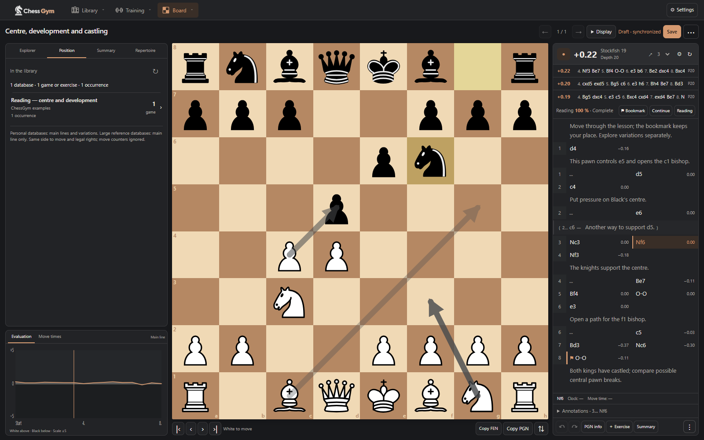
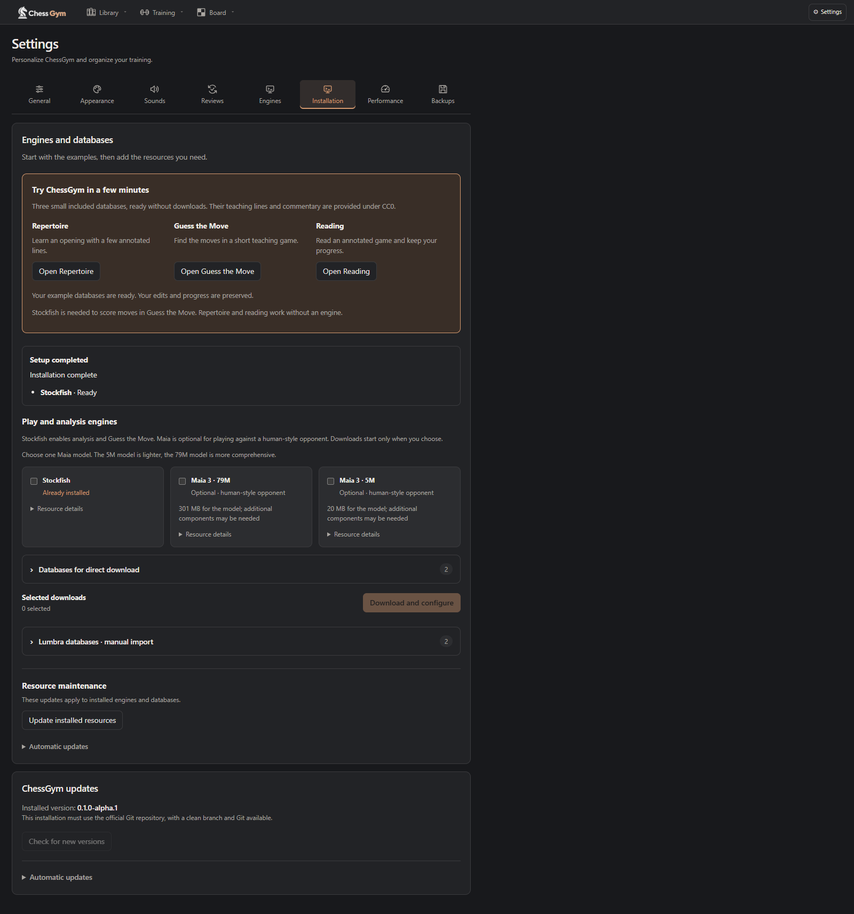
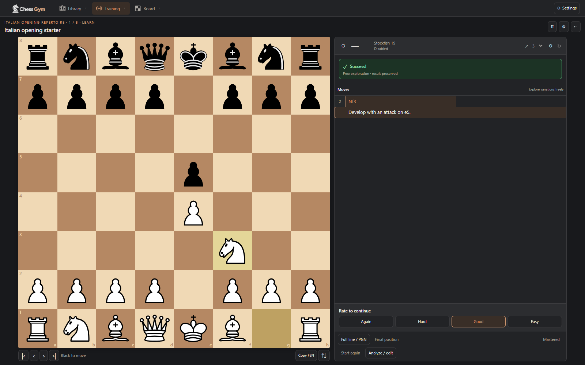
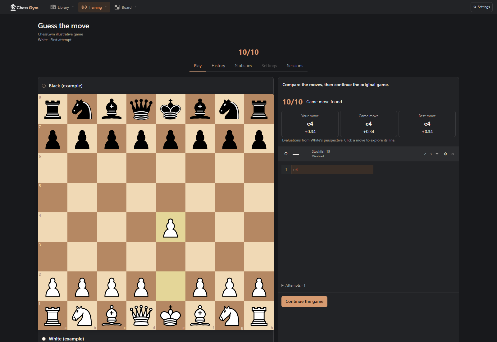

# ChessGym

**An open-source chess study workspace, built by players for players.**

ChessGym brings your games, opening repertoires, analysis and training into one application that runs on your own computer. You keep your PGNs, your notes and your progress. There is no ChessGym account to create and no subscription.

This is the first community alpha, **v0.1.0-alpha.1**. The core tools are already usable, but the project is young: there are rough edges, installation still needs Python, and feedback will shape what comes next. Contributions from players, developers, translators and testers are welcome.

[Get started](#install-on-windows) · [Guide en français](LIRE-MOI.md) · [Detailed guide](USAGE.md) · [Contribute](CONTRIBUTING.md) · [Release notes](RELEASE_NOTES.md)



## What you can do

- **Keep a PGN library.** Organize personal games and study material, edit annotations and variations, search games and positions, and import large reference collections separately.
- **Analyse and learn from games.** Use Stockfish, explore opening moves and transpositions, review a game report, and turn a position into an exercise. Public Chess.com and Lichess games can be synchronized into your library.
- **Build and practise a repertoire.** Keep your own opening lines, compare them with reference games and review moves with spaced repetition.
- **Study a game or lesson.** Follow annotated PGNs, save a reading bookmark and come back to the same position.
- **Train in different ways.** Try Guess the Move, puzzles, Puzzle Storm, blindfold visualization, coordinates and square colours. Play against Stockfish or optional Maia 3, with saved games and configurable clocks.
- **Track your work.** Set daily or weekly training goals, use a personal programme and look back at your activity and results.

There is overlap with the kinds of work people do in ChessBase, Chessable or Chessbook. ChessGym is a smaller, independent project bringing some of those workflows together; it does not claim the same depth, polish or content catalogue. It does not include commercial courses or proprietary game databases.

The interface is available in twelve languages: English, French, Spanish, German, Portuguese, Italian, Russian, Simplified Chinese, Japanese, Korean, Arabic and Hindi. Imported games and notes keep their original text.

## Install on Windows

Windows with **Python 3.12** is the tested starting point. You need an internet connection to install dependencies and download optional resources; local study content remains on your computer.

1. Install [Python 3.12](https://www.python.org/downloads/) and [Git](https://git-scm.com/downloads/win).
2. Open PowerShell in the folder where you want to keep ChessGym, then run:

```powershell
git clone https://github.com/vincentinogec/chessgym-community.git
cd chessgym-community
py -3.12 -m venv .venv
.\.venv\Scripts\python.exe -m pip install -r requirements.txt
```

3. Double-click **Demarrer ChessGym.cmd** in the project folder. Your browser opens [localhost:8765](http://127.0.0.1:8765).
4. In the welcome screen, choose **Add the examples**. Then leave Stockfish selected and choose **Download and configure**.

You can also download and extract the source ZIP from [Releases](https://github.com/vincentinogec/chessgym-community/releases). In that case, open PowerShell in the extracted folder and start at the virtual-environment command above; Git is not needed to run the ZIP version. In-app application updates require a Git checkout.

There is no account, password or login screen. Three small examples are included: an Italian repertoire, a Guess the Move game and an annotated reading lesson. They are editable, use original French/English teaching comments under [CC0](examples/README.md), and do not require a large database download. Repertoire and reading work without an engine; Guess the Move uses Stockfish to score your moves.



**Maia and large databases are optional.** Add them later from **Settings → Installation**. The full Lichess puzzle bank and large reference collections can use several gigabytes. Lumbra imports use a separate browser download and their own non-commercial licence; see the [resource guide](USAGE.md#first-run-resources-and-updates).

Close the browser when you are done studying. To stop the background application as well, use **Arreter ChessGym.cmd**. To start it again, use **Demarrer ChessGym.cmd**.

If you prefer to keep it in a terminal:

```powershell
.\.venv\Scripts\python.exe run.py
```

Press Ctrl+C in that terminal to stop it.

## A local application

ChessGym serves its interface to a browser on the **same computer**. It is self-hosted in this local sense: your study data lives in your installation, and you control the source. This alpha does not offer LAN access, remote hosting or multiple users. The supplied launcher binds to loopback, and non-local requests are refused.

External requests are made when you choose online features, such as resource downloads, public-game synchronization or an online opening explorer. Engine calculations and local PGN study run locally. No AI service is required to use ChessGym.

**Settings → Performance** lets you choose usable CPU cores, Stockfish cache memory and import workers, with Economy and Balanced recommendations adapted to your machine. The memory setting controls the Stockfish caches, not the total memory used by Maia and imports. Analysis supports a chosen duration, a target depth or continuous analysis; the engine and available resources determine how deep it can go.



## Keep your work safe

Use **Settings → Backups** to create a personal backup before updating or experimenting. It includes your study data, settings and progress, but excludes the large downloadable reference stores and engine installations. Keep those separately if you need to move computers. The [backup and restore guide](USAGE.md#backups) explains the difference between personal and full backups.

Features and data formats can still evolve during the alpha series. Test a change with example data first, especially if you modify the source.

## Status and known limits

- The application has been tested on Windows with Python 3.12, including a new virtual environment, actual Stockfish installation, the three examples and persistence after restart. That test used a Windows machine where Python and Chrome were already installed.
- Linux has a limited automated startup/API check. [Linux setup instructions](USAGE.md#install-on-linux) are available for contributors, but a complete Linux or macOS installation and browser workflow has not been validated.
- Large downloads and imports take time and disk space. External services may be unavailable or rate-limit requests. Maia and dataset setup need more testing across machines.
- Local training ratings are training indicators, not official playing ratings. Reference searches can report partial results when a configured search bound is reached.
- Guess the Move Mix is not part of this release; classic Guess the Move is included.

See [release notes](RELEASE_NOTES.md), [the changelog](CHANGELOG.md) and the [current CI results](https://github.com/vincentinogec/chessgym-community/actions) for scope and validation.

## Help build it

The aim is an adaptable tool for players, made better by the people who use it. Try an exercise, report an awkward workflow, improve a translation, help with setup on another platform or contribute a focused code change. You do not have to be a developer to help.

The code is Python with a browser interface in JavaScript. You can read it, fork it and adapt it to your own study habits, including with AI coding tools. AI-assisted contributions are welcome when the contributor understands and checks the result; they follow the same review and testing expectations as any other contribution.

Start with [CONTRIBUTING.md](CONTRIBUTING.md), [open an issue](https://github.com/vincentinogec/chessgym-community/issues) or look at existing discussions in the issue tracker. For a security issue, follow [SECURITY.md](SECURITY.md).



## Licence and acknowledgements

ChessGym's own source code is licensed under **GNU AGPL version 3 or later** (`AGPL-3.0-or-later`), except where a file or notice says otherwise. See [LICENSE](LICENSE). The project is provided without warranty.

Engines, models, datasets, libraries and bundled artwork keep their own licences. See [THIRD-PARTY-NOTICES.md](THIRD-PARTY-NOTICES.md), [PIECE-SETS-NOTICES.md](PIECE-SETS-NOTICES.md) and [the example provenance](examples/README.md). Stockfish, Maia and third-party databases are downloaded separately. The interface sounds are Kenney assets under CC0; the logo was generated with ChatGPT, as recorded in the notices.

ChessGym is independent of ChessBase, Chessable, Chessbook, Lichess, Chess.com, Stockfish and Maia. Their names identify the relevant products, sources or integrations; they do not imply endorsement.
